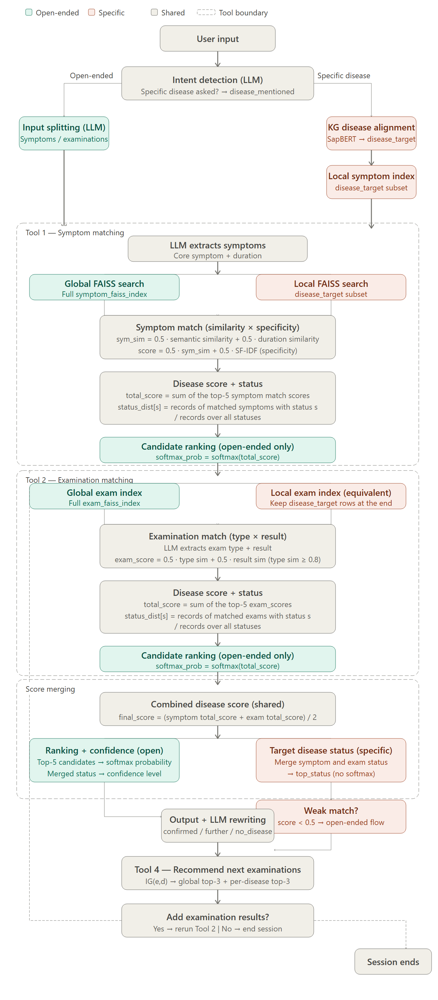

# Knowledge-Graph-Based Diagnostic Assistant (NTU MSDS Capstone)

Code for a four-module pipeline that turns online doctor-patient conversations into an
event-centred medical knowledge graph and uses it for retrieval-augmented diagnosis.
The current scope is the diabetes cluster.



## Repository layout

| Folder | Content |
| --- | --- |
| `module1_llm_extraction/` | LLM (gpt-5-mini) extraction of symptoms, examinations, disease type and confirmation status from each conversation. The prompt is kept in Chinese because it is sent to the model as-is. |
| `module2_data_cleaning/` | `MAIN.py` runs STEP1-STEP5: disease normalisation (SapBERT + UMLS + KMeans), event splitting, symptom-duration cleaning, and LOINC mapping of examination types and needs. Pipeline notes are in `docs/`. |
| `module3_knowledge_graph/` | Neo4j import script (`import_kg.cypher`), schema description and check queries. |
| `module4_rag_agents/` | Tool1 (symptom matching), Tool2 (examination matching), Tool3 (combined diagnosis), Tool4 (examination recommendation), Agent A (open diagnosis) and Agent B (disease-specific query). `examples/` holds the usage snippets. |

## Setup

```bash
pip install pandas openpyxl openai sentence-transformers transformers torch faiss-cpu scikit-learn neo4j langchain langchain-openai langchain-community
cp .env.example .env   # then fill in your keys
```

All credentials are read from environment variables: `OPENAI_API_KEY`, `NEO4J_URI`,
`NEO4J_USER`, `NEO4J_PASSWORD`.

## Data (not included)

- Input conversations (`*.xlsx`) and all intermediate CSV files are not published because they
  contain patient conversations.
- UMLS files (`MRCONSO.RRF`, `MRSTY.RRF`) require a UMLS licence from the NLM.
- LOINC (`Loinc_2.82.zip`) can be downloaded from https://loinc.org after registration.

## Running

1. Module 1: put the input Excel file and the prompt next to `extract_information.py`, set the paths at the top of the file, and run it.
2. Module 2: place the input zip, `extracted_information.csv`, the UMLS and LOINC files in `module2_data_cleaning/` and run `python MAIN.py`.
3. Module 3: copy the three cleaned CSV files into the Neo4j import folder and run `import_kg.cypher`.
4. Module 4: run from `module4_rag_agents/` (AgentA / AgentB import the tool files). The files in `examples/` are usage snippets for the end of the matching file (or a notebook cell after it); they call the module functions without importing them. Set `rebuild_index=True` on the first run to build the FAISS indexes.

Runtime messages and patient-facing replies in Module 4 are in Chinese because the system answers in Chinese; code comments are in English.
